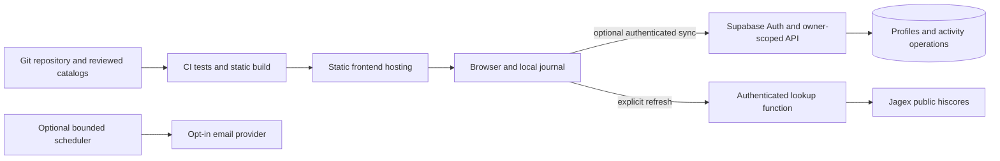

# Later hosting plan

Decision status: **proposed**, November 1, 2026. No services or purchases are
authorized merely by this plan. Prices below are USD planning references,
checked on that date; recheck availability, terms, tax and included usage before
making a commitment.

## When to change the architecture

Stay on the free static site while users are validating catch-up, planning and
local tracking. Add a backend when a specific need is demonstrated:

| Trigger | Smallest appropriate change |
| --- | --- |
| Cross-device character profiles | Activate and live-test the prepared dedicated Supabase integration |
| Cross-device DailyScape journal | Implement an event-based sync model; existing profile sync is insufficient |
| Hosted authenticated hiscores imports | Deploy the prepared authenticated lookup and configure public client values |
| Reliable email reminders | Add an opt-in scheduler, delivery service and unsubscribe flow |
| Custom domain | Configure DNS/HTTPS and plan browser-data migration; a server is not automatically required |
| Paid SaaS / subscriptions | Move to a suitable frontend host before the commercial launch |
| Sustained usage beyond an included limit | Measure the actual resource, then change only that service |

GitHub's commercial SaaS restriction is documented in its [Pages limits](https://docs.github.com/en/pages/getting-started-with-github-pages/github-pages-limits).
More catalog entries alone are not a reason to buy a database.

## Recommended later architecture

Keep the static build. Use **Cloudflare static hosting plus a dedicated Supabase
project** when an account-based product is justified. Evaluate Workers Static
Assets for a new deployment; Cloudflare Pages is also compatible with `dist/`
and provides a straightforward Git-based option. Check each service's current
setup and limits before choosing between them.



There is no need for an always-running VM, a separate web framework, realtime
subscriptions or both a Cloudflare proxy and a Supabase proxy for the same job.
The existing Supabase Edge Function can handle authenticated lookup. Add a
Worker only when its specific scheduling/proxy requirement justifies it.

### Deployment shape when the trigger is met

For the later static host, retain Node 22 and the current build:

```sh
npm ci
npm test
npm run build
```

Publish `dist/` as static assets, using repository-root source. There is no
long-running Node start command in production; `scripts/serve.mjs` is a local
preview/proxy. The query-based views do not require a clean-path SPA fallback.
Test both a root domain and any retained `/rune-return/` base path explicitly.

The same public build variables remain applicable:

- `RUNERETURN_SUPABASE_URL`
- `RUNERETURN_SUPABASE_PUBLISHABLE_KEY`
- Optional `RUNERETURN_CHARACTER_API_URL`

Leave them unset for a static-only deployment. Private SMTP credentials, server
keys and any future billing webhook secrets belong only in their respective
server services. A frontend deployment does not deploy the Deno Edge Function,
apply SQL or enable journal synchronization automatically. Follow
[account setup](../SETUP-ACCOUNTS.md) for the prepared integration and write a
separate reviewed migration for any future journal tables.

Keep public catalogs as immutable/versioned static artifacts served through the
CDN. Store player actions and preferences in the database. Cache upstream
lookups and keep only the latest character snapshot by default.

## Operating scenarios and costs

| Scenario | Service approach | Planning cost before variable extras |
| --- | --- | --- |
| Current basic site | Existing GitHub Pages, local journals, no backend | $0 incremental hosting subscription under the current free-eligible setup |
| Small account pilot | Static frontend + Supabase Free | Potentially $0 infrastructure subscription within included usage; SMTP/domain choices may cost extra |
| Small production account service | Static frontend + one Supabase Pro project | From $25/month for Supabase, plus SMTP/domain/usage extras |
| Additional paid Worker service | Only if an actual server-side requirement needs it | Add a $5/month Workers minimum; roughly $30 combined base when also using the preceding Supabase scenario |

Supabase Free currently includes a 500 MB database and can pause after a week of
inactivity. Pro starts at $25/month with one project included; these are not
unlimited-use prices. [Supabase pricing](https://supabase.com/pricing).

Cloudflare documents free, unlimited static-asset requests; function execution
has separate billing and limits. Its paid Workers plan has a $5/month minimum.
Do not assume an app request that runs a function is a free static request.
[Static asset billing](https://developers.cloudflare.com/workers/static-assets/billing-and-limitations/),
[Workers pricing](https://developers.cloudflare.com/workers/platform/pricing/),
[Pages limits](https://developers.cloudflare.com/pages/platform/limits/).

Supabase's built-in email sender is restricted and unsuitable for general-user
delivery. Plan custom SMTP before opening magic-link sign-in publicly; SMTP is
also separate from a future scheduled digest feature. [Auth SMTP documentation](https://supabase.com/docs/guides/auth/auth-smtp).

Domain registration, taxes, usage overages, extra projects, email volume and
optional add-ons are not included in these examples. The frontend's custom
domain is distinct from an optional paid Supabase API custom-domain add-on;
the latter is not necessary merely to brand the website.

## Prevent database growth from becoming the product

- Save completions and explicit changes, not a snapshot for every player every day.
- Preserve old completions; do not silently truncate history to stay below quota.
- Reference an immutable estimate version instead of duplicating a long basis
  paragraph in every cloud completion. Keep exports understandable without the server.
- Retain only the latest hiscores snapshot unless a user explicitly enables a
  designed progression-history feature with its own storage budget.
- Use cursor pagination and indexes scoped by owner, character and sequence/time.
- Bound diagnostic logs and request caches; they are not user journals.

Illustrative capacity calculation, **not a measured row size**: 100 active users
× 10 records/day × 1 KB/record × 365 days is approximately **365 MB/year of
payload**, before indexes, database overhead, estimate versions or operations.
Cloud sync is therefore not “free forever” just because early traffic is small.
Measure real database bytes per retained completion during the pilot.

Set a monthly budget before activation. Proposed operational alerts are 50%,
75% and 90% of the agreed quota/budget, with a review before buying capacity.
Keep static browsing available during backend outages and prefer pausing new
expensive work to deleting history. Supabase's Pro Spend Cap covers only certain
usage items; it is not a universal hard invoice ceiling. [Cost controls](https://supabase.com/docs/guides/platform/cost-control).

## Account and sync design prerequisites

The current `rr_characters` table stores the latest profile/progress document.
It has a bounded JSON field and latest-write-wins behavior. Do not put an
unbounded journal into that field. DailyScape is currently separate and local.

Use the proposed event/estimate design in [Data and estimates](DATA-AND-ESTIMATES.md):
stable operation IDs, owner-scoped records, explicit guest import, idempotent
writes and undo operations that preserve the original completion. Resolve
same-record editing conflicts explicitly; never replace the entire cloud journal
with the newest browser JSON.

Before opening public accounts, verify actual RLS isolation between two users,
authentication expiry, redirects, SMTP, rate limits, account deletion and backup
restoration against a real test project. The current per-instance lookup limiter
is not a global anti-abuse quota.

## Migration sequence

1. **Prepare locally.** Complete full backup/restore, storage versioning and a
   tested local journal migration. Keep the current site useful without accounts.
2. **Choose an origin.** Check domain availability/pricing separately. Record
   the exact future URL, repository subpath strategy and redirect behavior.
3. **Create staging.** Deploy the same `dist/` to the chosen static host. Use a
   dedicated test backend and synthetic accounts; keep production data separate.
4. **Verify live integrations.** Exercise signup, expired links, two-user RLS,
   profile import, lookup caching, journal merge and deletion. Do not claim a
   passing mocked test establishes production behavior.
5. **Prepare users' data.** Download versioned backups from the old origin.
   Explain that browser storage does not automatically follow a domain change.
   Keep auth tokens out of exported files. Offer an explicit import preview.
6. **Cut over.** Update DNS/HTTPS, auth Site URL and exact redirect URLs, API CORS
   origins, public build variables and source links. Preserve query routes and
   validate relative asset URLs from the new base path.
7. **Verify independently.** Test a clean browser, a returning user with a
   backup, both games, two devices and a backend outage. Check actual usage.
8. **Retain a recovery path.** Keep the old free site available for a defined
   transition period, proposed 30 days, with migration/export guidance. Do not
   permanently redirect away before users can export local data.
9. **Close the transition deliberately.** Reconcile imports and document any
   unsynced records before changing the old deployment. Maintain export access.

Rollback should restore the previous frontend and disable affected new writes
without deleting either device copies or cloud operations. A domain rollback
must not assume browser data on the new origin exists on the old origin.

## Release gates

No paid infrastructure commitment until there is an owner-approved budget and
a demonstrated requirement. No paid product launch until recovery, data export,
service cancellation and support are usable. No plugin/account import promise
until the current provider interface and permissions have been verified.
